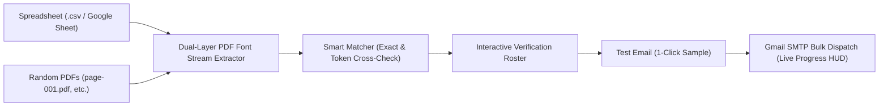

# 🎓 CertiFlow — Automated Certificate Verification & Bulk Dispatch Hub

[](https://www.python.org/downloads/)
[](https://flask.palletsprojects.com/)
[](https://opensource.org/licenses/MIT)
[]()

> **Production-grade web application to sort, reverse-engineer PDF font streams, cross-match against spreadsheets, and dispatch bulk certificates via Gmail SMTP with zero mismatches.**

---

## ⚡ The Problem Solved

When exporting bulk certificates from design tools such as **Canva, CorelDRAW, Adobe Illustrator, or Google Drive**, the split output files (`page-001.pdf`, `page-002.pdf`, etc.) are frequently dumped **out-of-order** with zero row correlation to the registration spreadsheet.

### Naive Automation = 100% Mismatch Disaster
Naive scripts that iterate through spreadsheets and attach files sequentially by row number result in **participants receiving someone else's certificate**. 

Furthermore, modern design tools do not write plain ASCII strings; they compress font subsets into `/ObjStm` streams with `/ToUnicode` hexadecimal character lookups, making standard text extraction fail.

### The CertiFlow Solution


1. **Direct Font Stream Decoding**: Decompresses internal PDF object streams, parses `/ToUnicode` CMaps, and translates raw hex glyphs into clean recipient names.
2. **Font-Size & Coordinate Filtering**: Targets recipient name baseline coordinates and typography styles, filtering out static dignitary titles and badges.
3. **Fuzzy & Token-Set Matching**: Reconciles name order variations (e.g. `Shivam Kumar` vs `Kumar Shivam`), middle names, and minor typos against the registration roster.
4. **Interactive Verification Roster**: Inspect certificates in an embedded viewer, adjust recipient emails inline, and toggle inclusions before sending.
5. **Polite SMTP Bulk Dispatch**: Personalized email delivery with TLS encryption, rate-limiting delays, and a real-time live console stream.

---

## 🚀 Quick Start

### 1. Clone the Repository
```bash
git clone https://github.com/Manish6201-g/Certiflow.git
cd Certiflow
```

### 2. Configure Environment
Copy the example environment file:
```bash
cp .env.example .env
```
Edit `.env` with your Gmail address and 16-character Google App Password:
```bash
GMAIL_USER=your-email@gmail.com
GMAIL_APP_PASSWORD=your-16-char-app-password
DEFAULT_SENDER_NAME=CodeZen Club
DEFAULT_REGARDS=CodeZen Club
PORT=5050
```

### 3. Launch the Web Application
Run the startup script:
```bash
./start.sh
```
Or start the server directly:
```bash
python3 -m pip install -r requirements.txt
python3 server.py
```
Open **[http://localhost:5050](http://localhost:5050)** in your browser.

---

## 🛠️ Step-by-Step Workflow

### Step 1: Provide Recipient Spreadsheet
- Upload any `.csv`, `.xlsx`, or `.tsv` file.
- Or paste your **Google Sheets URL** directly (CertiFlow auto-converts `/edit` to `/export?format=csv` and fetches live rows).
- The column detection engine automatically maps **Name**, **Email**, and **Roll No / Duty** fields.

### Step 2: Upload Certificate PDFs
- Drag and drop a folder of PDFs, multiple `.pdf` files, or a `.zip` archive.
- File names can be arbitrary (e.g. `page-001.pdf`, `cert-51.pdf`) — CertiFlow matches by content, not filename.

### Step 3: Analyze & Auto-Match
- Click **"⚡ Analyze PDFs & Match Recipients"**.
- View the real-time **Verification Roster** with color-coded confidence badges:
  - 🟢 **100% Exact Match**: Verified automatically.
  - 🔵 **Fuzzy Match (>80%)**: Handles minor spelling or token ordering variations.
  - 🟡 **Missing Email in Sheet**: Highlighted editable input field to enter missing addresses on the fly.
  - 🔴 **Unmatched**: Certificates not present in the roster.
- Click **"Preview"** on any entry to inspect the PDF certificate in an embedded viewer.

### Step 4: Configure Email & Dispatch
- Select pre-configured templates (**Participant** or **Coordinator** presets).
- Customize the subject line and message body using dynamic tokens: `{name}`, `{regards}`.
- Click **"✉️ Send Test"** to deliver a single real certificate to your own email to verify formatting before bulk sending.
- Click **"🚀 Dispatch All Verified Certificates"** to initiate delivery with live progress tracking, polite rate-limiting, and pause/resume controls.

---

## 🎨 Built-In Typography Studio

Need to quickly fix a name typo or regenerate a single certificate? 
The **Typography Studio** tab provides a client-side vector canvas editor to customize:
- Recipient Name
- Font Family (Axiforma Alternative, Plus Jakarta Sans, Montserrat, Poppins)
- Font Size & Weight
- Color Picker (`#0A3771`) & Baseline Y-offset
- 1-Click PNG Download

---

## 📁 Repository Structure

```
Certiflow/
├── server.py              # Flask API & Dual-layer PDF CMap extraction engine
├── start.sh               # 1-Click execution script
├── requirements.txt       # Python dependencies
├── .env.example           # Configuration template
├── .gitignore             # Ignored files (credentials, uploads, cache)
├── README.md              # Documentation
├── index.html             # Single-page application interface
├── style.css              # Design tokens & responsive styles
├── app.js                 # Frontend application logic & live HUD stream
├── data.js                # Preloaded audit records
├── assets/                # Logos and template graphics
└── sample_data/           # Safe demo CSV templates
    ├── participants_sample.csv
    └── coordinators_sample.csv
```

---

## 🔒 Security Best Practices

- **Zero Credential Leaks**: Never commit `.env` or application passwords. `.gitignore` is pre-configured to exclude all `.env` files and session uploads.
- **Polite SMTP Rate Limiting**: Built-in 1.0-second delay between dispatches prevents hitting Google Gmail SMTP rate caps.
- **Fail-Safe Disconnect Recovery**: Automatic re-authentication on transient network disconnects.

---

## 📄 License

This project is licensed under the [MIT License](LICENSE).
